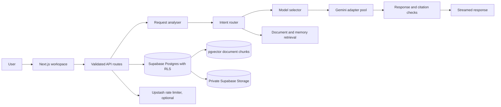

# Architecture

The server owns provider credentials, model selection, usage accounting, document retrieval, and tool permissions. The client receives response text, citations, and safe progress metadata only. User memory is opt-in. Demo mode uses labelled sample data and bypasses live model and database operations by design.

## Brain pipeline

`validate -> analyse intent/language/complexity -> retrieve consented memory and permitted document chunks -> choose workflow/model -> execute allowlisted tools -> generate -> evaluate/citation-check -> stream -> record usage`

No hidden reasoning is stored or displayed. Evaluation checks response shape and citation references; it does not claim to prove factual correctness.
